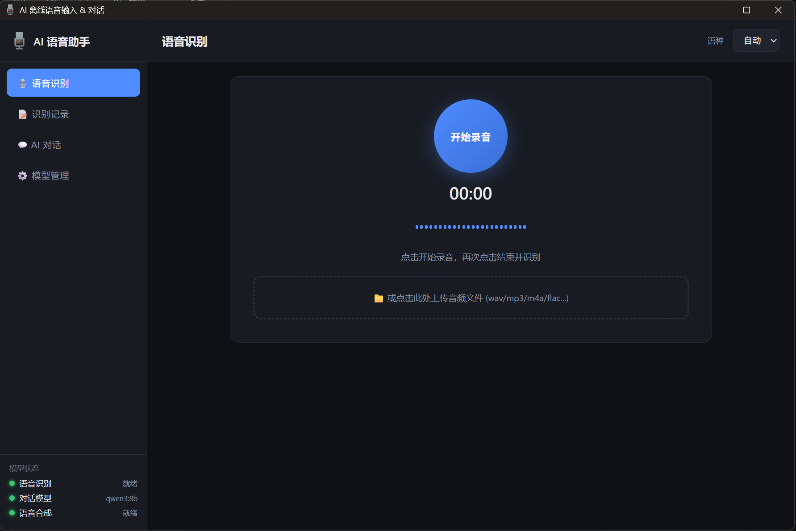
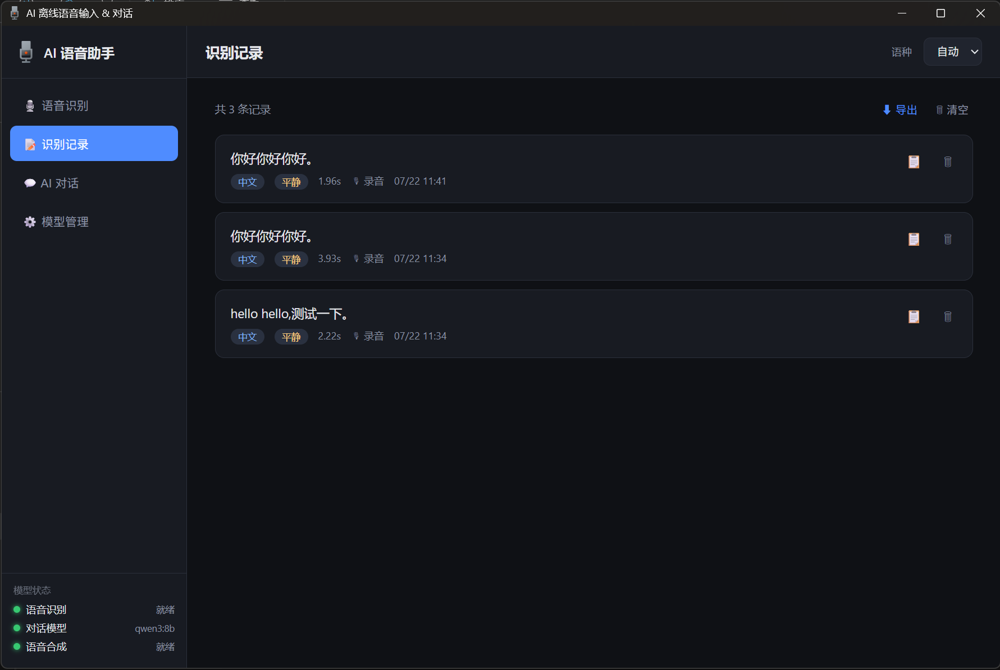
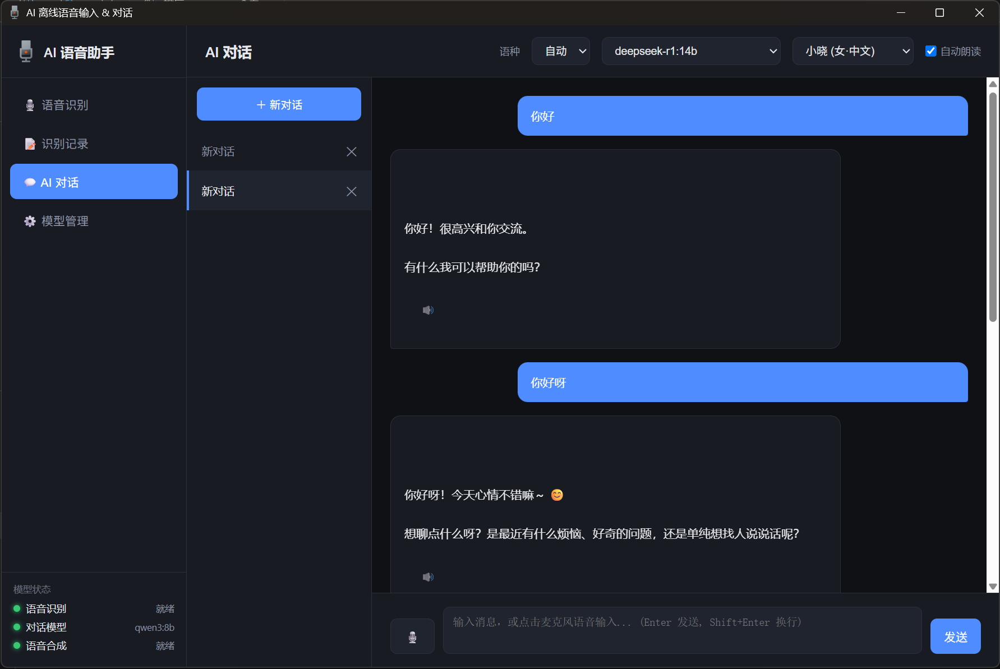
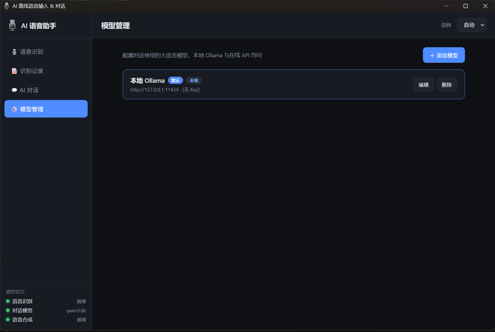
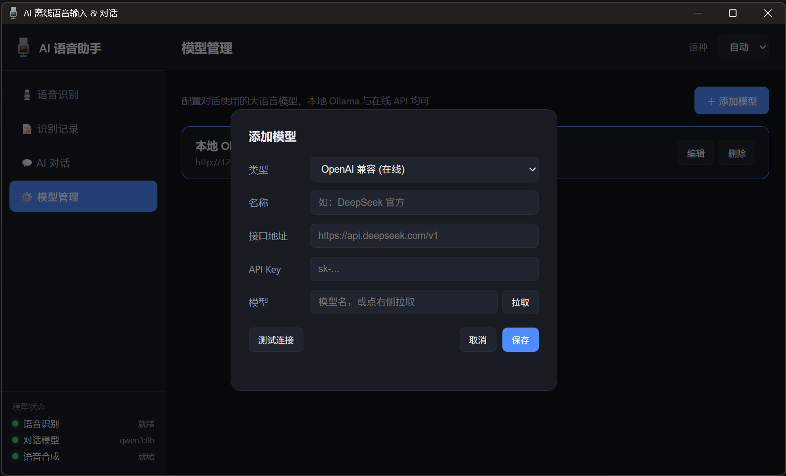

# AI 离线语音输入 & 对话

<p align="right"><b>当前版本：v1.1.0</b></p>


<p align="center">
  
</p>

完全离线的 **语音识别 + 语音合成 + 大模型对话** 一体化桌面应用。
说话 🎙️ → 识别成文字 → 大模型回答 → 语音朗读 🔊，全流程本地运行，隐私安全。

## 功能

- **🎙️ 语音识别** — 浏览器实时录音识别 / 上传音频文件识别，支持中/英/粤/日/韩，自动语种检测 + 情感识别
- **📝 识别记录** — 自动保存识别历史，支持复制、导出文本
- **💬 AI 对话** — 本地或在线大模型对话，支持语音输入、流式回复、多会话管理
- **🔊 语音合成** — AI 回复自动朗读，多发音人（Kokoro TTS），构成完整语音对话闭环
- **⚙️ 模型管理** — 默认接入本地 Ollama，也可添加任意 OpenAI 兼容的在线大模型（URL + API Key + 模型）
- **🔒 完全离线** — ASR 用 SenseVoice ONNX，TTS 用 Kokoro，LLM 默认走本地 Ollama

## 界面预览

### 语音识别
录音或上传音频，实时转写为文字，并显示语种、情感、时长。



### 识别记录
所有识别结果自动入库，可复制、导出、清空。



### AI 对话
语音或文字提问，大模型流式回答，回复可自动 / 手动语音朗读；左侧多会话管理，顶栏可切换模型与发音人。



### 模型管理
默认内置本地 Ollama（127.0.0.1:11434），可添加在线大模型并设为默认。





## 快速开始

### 方式一：直接运行打包版（推荐给最终用户）

从 `dist/AI语音助手/` 目录双击 **AI语音助手.exe** 即可，**界面秒开**，模型在后台加载（左下角实时显示加载状态）。

> 分发时发送整个 `dist/AI语音助手/` 文件夹，并确保 `models/` 文件夹在该目录下（见下方“打包与分发”）。
> 对话功能需本机运行 Ollama；语音识别、语音合成完全独立、无需 Ollama。

### 方式二：源码运行（开发者）

**环境要求**
- Python 3.10 ~ 3.12
- [Ollama](https://ollama.com/)（如需本地对话），并已拉取模型（推荐 `qwen3:8b` / `qwen3.5:9b`）

**安装依赖**
```bash
uv venv .venv --python 3.12          # 或 python -m venv .venv
.venv\Scripts\python.exe -m pip install -r requirements.txt
```

**启动（三选一）**
```bash
# 桌面 GUI（推荐）
双击 启动.bat            # 带日志窗口
双击 启动-无黑窗.bat     # 仅应用窗口
.venv\Scripts\python.exe gui.py

# 浏览器模式（仅后端）
.venv\Scripts\python.exe server.py   # 然后访问 http://127.0.0.1:8000
```

## 模型管理

进入「⚙️ 模型管理」页：

- **本地 Ollama**（默认）：无需配置，自动读取 `127.0.0.1:11434` 已安装的模型。
- **在线大模型**：点「＋ 添加模型」，填写
  - 类型：OpenAI 兼容
  - 接口地址：如 `https://api.deepseek.com/v1`
  - API Key：如 `sk-...`
  - 模型：可点「拉取」自动获取列表，或手动填写
- 支持测试连接、设为默认、编辑、删除；配置持久化到本地 `data.db`（API Key 不回传前端明文）。
- 对话页顶栏的模型下拉按来源分组，本地与在线模型可随时切换。

## 语音合成 (TTS)

- 模型：Kokoro v1.0（24kHz，多语言多发音人）
- 中文 G2P：misaki[zh]（jieba）；英文 G2P：espeak-ng
- 发音人：中文 8 个（小晓 / 小妮 / 小北 / 小艺 / 云希 / 云健 / 云扬 / 云夏），另有多个英文发音人
- 对话页顶栏可选发音人、开关「自动朗读」；每条 AI 回复也有 🔊 手动朗读按钮

> 首次英文合成需 spaCy 英文小模型 `en_core_web_sm`（纯中文对话不需要）。
> 离线安装：下载 `en_core_web_sm-3.8.0-py3-none-any.whl` 后 `pip install`。

## 打包与分发

双击 `打包exe.bat`（或运行 `pyinstaller AI语音助手.spec --noconfirm`），
在 `dist\AI语音助手\` 生成 **onedir 免解压** 应用目录（约 1.2GB，主 exe 约 90MB）。

采用 onedir 模式是为了 **秒开界面**——onefile 单文件每次启动需解压上千兆依赖（约 2~3 分钟），onedir 免解压，双击后约 1 秒即出界面。

**分发结构**（模型体积大，不打进 exe，需放在应用目录下）：
```bash
AI语音助手/
├── AI语音助手.exe
├── _internal/           # PyInstaller 依赖 (自动生成)
└── models/              # 手动放到此处
    ├── Sensevoice-Small-ONNX/
    └── KokoroTTS/
```

运行时会在应用目录生成 `data.db` 保存识别记录、对话历史与模型配置。

## 启动流程（为何秒开）

1. 双击 exe → onedir 免解压，后端仅初始化数据库，**界面立即弹出**
2. 界面加载完成后，才在后台异步加载 ASR / LLM / TTS 三个引擎
3. 左下角「模型状态」实时显示各引擎：🟡 加载中 → 🟢 就绪 / 🔴 失败
4. 哪个引擎亮绿灯，对应功能即可使用（ASR 最快，TTS 因 torch 稍慢）

## 项目结构

```bash
.
├── gui.py              # 桌面 GUI 启动器 (pywebview 原生窗口)
├── server.py           # FastAPI 后端 (ASR/TTS/LLM/模型管理 接口)
├── asr_engine.py       # SenseVoice ONNX 语音识别引擎
├── llm_engine.py       # LLM 对话引擎 (Ollama + OpenAI 兼容)
├── tts_engine.py       # Kokoro TTS 语音合成引擎
├── db.py               # SQLite 存储层 (记录/会话/消息/模型配置)
├── frontend.html       # 单页 Web 前端
├── paths.py            # 源码/打包 路径适配
├── AI语音助手.spec     # PyInstaller 打包配置 (onedir)
├── VoiceRecorderApp.png / app.ico   # 应用图标
├── requirements.txt    # Python 依赖
├── 启动.bat / 启动-无黑窗.bat / 打包exe.bat
├── imgs/               # 界面截图
└── models/
    ├── Sensevoice-Small-ONNX/   # ASR 模型
    └── KokoroTTS/               # TTS 模型 (含多发音人)
```

## 技术栈

| 组件 | 技术 |
|------|------|
| 语音识别 | SenseVoice-Small ONNX (kaldi-fbank + LFR → Encoder → CTC → SentencePiece) |
| 语音合成 | Kokoro v1.0 (misaki 中文 G2P + espeak-ng 英文 G2P) |
| 大模型 | 本地 Ollama / 任意 OpenAI 兼容在线接口 |
| 后端 | FastAPI + Uvicorn |
| 桌面外壳 | pywebview (WebView2) |
| 存储 | SQLite |
| 前端 | 单页 HTML + Web Audio API |
| 打包 | PyInstaller (onedir) |
